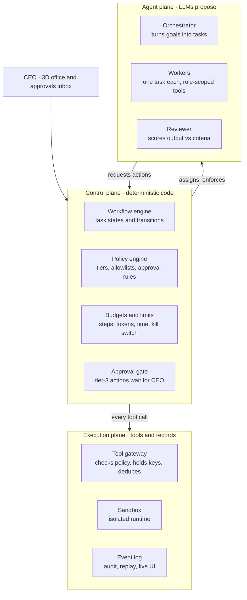
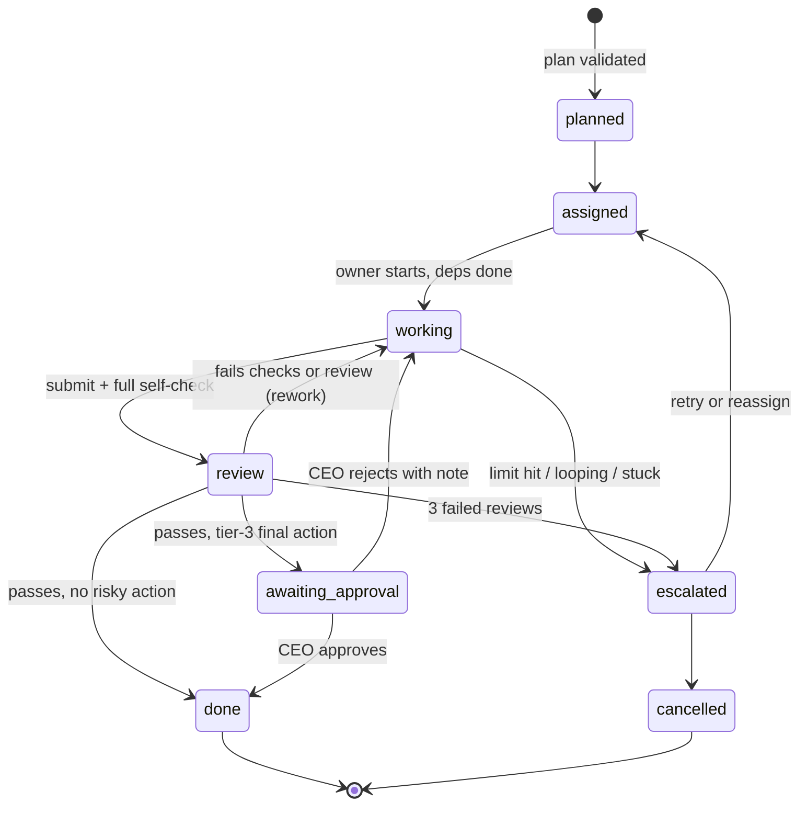

# AI Company: agent control architecture

The AI Company is a workspace where each AI agent works as an employee, shown in a 3D office. One **orchestrator** agent takes goals from the CEO (the user), splits them into tasks and hands them to **worker** agents in departments such as Engineering, Marketing, Sales and Support. A **reviewer** agent checks finished work.

**Core principle: LLMs propose, deterministic code decides.** Agents never change state, call a tool or spend money directly. Every action goes through a control plane of ordinary code that enforces permissions, budgets, quality gates and approvals. No prompt can override it.

Design goals:

- **Safe by default.** Irreversible or costly actions always need a human sign-off.
- **Predictable.** Every task follows one state machine, with hard limits on steps, tokens and time.
- **Quality-checked.** No task is done until it passes automated checks and an independent review.
- **Fully auditable.** Every event is logged and can be replayed, which also drives the 3D office view.

## System layers

Agents send requests up to the control plane, which checks them against the rules and then carries them out through the tool gateway. Every result is written to the event log, which the 3D office reads to show what each agent is doing.

| Component | Package | Status |
| --- | --- | --- |
| Workflow engine, policy engine, limits, event log | `packages/core` | Done |
| SQLite and Postgres event stores, HTTP + WebSocket API | `apps/server` | Done |
| Orchestrator, worker, reviewer agent loops, model providers | `packages/agents` | Done: scripted models (M3a), live on `qwen3:8b` (M3b) |
| Tool gateway: executors, workspace tools, credentials, timeouts, retries, rate limits | `packages/gateway` | Done (M4); real connectors come with the departments (M7) |
| 3D office UI | `apps/office` | Prototype (simulated agents) |

## Agent roles

| | Orchestrator | Worker | Reviewer |
| --- | --- | --- | --- |
| Job | Turns goals into tasks, assigns them, tracks progress, reports to the CEO | Completes one task | Scores a finished task against its acceptance criteria |
| Tools | Engine commands only: `submitPlan`, status queries | Real-world tools on its role's allowlist, plus `submit_work` and `report_blocked` | None: it receives the output and the criteria |
| Can do the work itself | No | Yes | No |
| Context | All goals, team roster and workload, task summaries | Its task, acceptance criteria, relevant files, role memory | The task, its criteria, the output |
| Model | Strongest available | Matched to the task | Strong, and different from the author's where possible |
| Output | Structured JSON plans | Work products plus a short summary | Pass or fail, a score, specific feedback |

Rules:

- Workers never talk to each other directly. All coordination goes through the orchestrator and the task board.
- The orchestrator reads worker summaries, never full transcripts, so its context stays small.
- A reviewer never reviews its own work. The engine enforces this.

## Task lifecycle

The workflow engine owns every task's state. Agents can only request a transition, and the engine checks the guard conditions before allowing it. The legal transitions are in `packages/core/src/state-machine.ts`.

| Transition | Guard checked by the engine |
| --- | --- |
| planned → assigned | Plan passed validation; owner is a worker with the tools the task needs |
| assigned → working | Caller is the owner; owner not paused or benched; dependencies done; goal budget left; company not paused |
| working → review | Worker submitted a summary and a self-check marking every criterion met |
| review → working | Automated checks failed, or the review failed (with feedback), and fewer than 3 attempts used |
| review → done | Review passed; no final action needing approval |
| review → awaiting_approval | Review passed, but the final action needs CEO approval |
| any → escalated | 3 failed check runs, reviews or rejections, a step / token / time / budget limit, a tool-call loop, or no progress |

## Risk tiers and permissions

Every tool is tagged with a risk tier, and the policy engine checks that tier on every call (`packages/core/src/policy.ts`).

| Tier | What it covers | Examples | Rule |
| --- | --- | --- | --- |
| 0 · Read | Reading data | Web search, read files, query CRM | Runs automatically |
| 1 · Internal write | Changes inside the company workspace | Draft a doc, create a branch, update a task | Runs automatically, logged |
| 2 · External, reversible | Visible outside but can be undone | Deploy to staging, schedule a post | Runs only if on the `autoApproveTier2` list; otherwise treated like tier 3 |
| 3 · Irreversible or costs money | Cannot be undone, or spends money | Send an email, deploy to production, pay, delete data | Never during work. Proposed as the task's `finalAction`, released only after review and CEO approval |

Permissions:

- **Per-role tool allowlist.** A call to a tool outside the agent's list is refused and logged.
- **Only workers call tools.** Orchestrators and reviewers are denied every real-world tool.
- **Credentials live in the tool gateway.** API keys and OAuth tokens never go into an agent's prompt or context. A tool gets only the credentials it declared, while it runs, and the gateway removes their values from every text it hands back or records.
- **Scoped access.** Tools get the narrowest scope that works: one repo, one mailbox, one CRM pipeline.
- **Policies are code.** Tiers, allowlists and approval rules are versioned configuration, changed only by the CEO, never by an agent.

## Quality gates

1. **Plan check** (`validatePlan`). The plan must give every task an owner who is a worker, acceptance criteria (none blank or repeated), a positive cost estimate and only tools the owner has. Dependencies must exist and form no cycle, and the total estimate must fit the remaining goal budget. Any failure rejects the plan with every reason listed; the orchestrator re-plans.
   The goal's planning status (`open` → `planned`, or `escalated`) lives in the engine: a plan is accepted only for an `open` goal, and after more than `maxReplans` (default 3) rejected plans the engine escalates the goal to the CEO. A goal whose budget runs out while it is still being planned is escalated too.
2. **Self-check** (`submitForReview`). The worker must mark every acceptance criterion met, or the submission is refused. A proposed `finalAction` must use a tool in the task's `requiredTools`: the plan decides what a task may do, so a worker cannot attach an email to a task that was planned only to write a file. The worker is offered only those tools as final actions.
3. **Automated checks** (`recordChecks`, [ADR 0005](decisions/0005-checks-and-rubric-review.md)). Deterministic checks by output type, run by the gateway after every submit and before any reviewer turn, and recorded as `checks.passed` / `checks.failed`.
   - Content files: they exist, their length, no placeholders, links that resolve.
   - Emails: schema, recipients on the CEO's allowlist, body length, placeholders, links a recipient can open.
   - A failure sends the work back with each reason and counts as a review attempt.
   - Results name the submission they are for, and record the sha256 of each file checked. If a file changes before the review, the checks run again and the verdict is refused, so a review is always of checked files.
   - The rules are the CEO's `checks` config.
   - Code checks (tests, lint, build) wait for a sandbox and come with the engineering department (M7).
4. **Independent review** (`recordReview`). A reviewer agent judges each acceptance criterion (met or not, with evidence). Code sets `passed` (every criterion met) and `score` (the share met). With `strictReview` (on in the server), the engine refuses a verdict until checks are recorded for the submission, and refuses a rubric that does not cover every criterion exactly once or contradicts `passed`. The rubric is stored with the review. A fail sends the task back to `working`.
5. **Human gate** (`decideApproval`). Tier-3 final actions wait for the CEO, who sees the output, the review score and the exact action. A rejection needs a note.

Three failed check runs, reviews or rejections (counted together) escalate the task instead of retrying again.

## Limits and safety controls

Defaults are in `DEFAULT_LIMITS` (`packages/core/src/engine.ts`) and are proposals to tune after testing. The server overrides them from `limits` in `apps/server/config/company.json`.

| Control | Scope | Default | At the limit |
| --- | --- | --- | --- |
| Step limit | Per task | 30 steps | Escalated |
| Token cap | Per task | 200,000 tokens (a turn that ends after its task stopped is still charged, as `task.usage`) | Escalated |
| Time limit | Per task | 30 minutes in `working` | Escalated |
| Review attempts | Per task | 3 | Escalated |
| Re-plans | Per goal | 3 rejected plans after the first | Goal escalated |
| Loop detection | Per task | Same tool + input 3 times in a row | Call denied, task escalated |
| Stuck detection | Per task | 5 minutes without activity (not counted while the company or the owner is paused; resuming restarts the clock) | Escalated by `checkStuck()` |
| Goal budget | Per goal | Set at goal creation; orchestrator and reviewer turns are charged to it with `recordGoalStep` | Warning at 80%, open tasks (and a goal still being planned) escalated at 100% |
| Circuit breaker | Per agent | 3 escalations in a row | Agent benched until the CEO un-benches it |
| Kill switch | Whole company | `pauseCompany()` | No task starts, no tool call is allowed, no plan or review is recorded, and agents stop before their next model turn |

## Reliability

- **Event sourcing.** Every state change is an event appended to the log. The engine's state is built only by replaying events through one reducer (`apply`), so `WorkflowEngine.fromEvents(log)` rebuilds the company exactly. The server rebuilds the engine from the event store (a local SQLite file, or Postgres) on every boot.
- **Durable before visible** ([ADR 0002](decisions/0002-durable-before-visible.md)). The engine stays synchronous; the server runs every request through one command queue that waits for the store's commit before anything leaves the process: HTTP responses, WebSocket messages and final actions for the gateway. A command's events commit in one transaction, so a crash never leaves half a command in the log. A failed write stops the server, which then rebuilds from the log.
- **One writer, append-only log.** The `events` table uses `seq` as its primary key and rejects UPDATE and DELETE (and TRUNCATE in Postgres, INSERT OR REPLACE in SQLite). Only one server writes to a company's log: SQLite holds an exclusive lock on a sidecar `company.db.lock` plus an exclusive lock on the log (no other process can even read it while the server runs), Postgres a session advisory lock.
- **Idempotency keys.** Every tool call and final action carries a key. A key is never allowed twice; a retry gets `{ kind: 'duplicate' }` and the gateway must not execute it again.
- **Checkpoints.** After each worker turn the conversation is saved to `DATA_DIR/agents.db`, outside the event log, so a crashed agent resumes where it stopped. A checkpoint belongs to one run of a task (`task.startedAt`); a retried or reassigned task starts over, and review feedback is appended when the review count went up. Losing the file only means a task's conversation restarts ([ADR 0003](decisions/0003-agent-runtime.md)).
- **Execution record.** Every allowed tool call ends in one recorded result (`tool.executed` / `tool.failed`), and a released final action runs only after its release is durable, with its result recorded as `action.executed` or `action.failed`. On boot, an allowed call with no result is recorded as interrupted (never re-run), and a released action with no result is re-run only if its tool dedupes by idempotency key (so a second run cannot act twice); otherwise it is recorded as failed for the CEO to check by hand.
- **Dead-letter queue.** Escalated tasks wait in one place for the CEO instead of disappearing or looping.
- **Timeouts on every tool call**, with retry and backoff only where a second try cannot act twice. See [Tool gateway](#tool-gateway-packagesgateway).

## Server (`apps/server`)

The server hosts the engine for one company. Configuration (tools and tiers, `autoApproveTier2`, limits, the agent roster) comes from `apps/server/config/company.json`, written by the CEO. On boot the roster is brought in line with the config through engine commands: new agents go through `registerAgent`, changed ones through `updateAgent` (event `agent.updated`), so a tool removed from the config is revoked. An agent deleted from the config keeps its history but loses every tool and is paused; if it is added back, it stays paused until the CEO resumes it. Changing an agent's kind fails the boot (and writes nothing); give the agent a new id instead.

**Event store.** By default the log is a SQLite file at `DATA_DIR/company.db` (`DATA_DIR` defaults to `<repo>/data` wherever the server is started from; the directory is created private, mode 0700), so the app needs no database server. The server logs when it creates a new, empty log, which is the sign of a wrong `DATA_DIR` or a missing `DATABASE_URL`. Commits are synchronous with `synchronous=FULL` and `fullfsync` (a real flush to disk on macOS), so each request costs one disk sync; that is plenty for one CEO on one machine. Back up the file only while the server is stopped, and never open it from inside the server process except through the store (see ADR 0002). Keep `DATA_DIR` out of folders synced by iCloud or Dropbox: sync tools ignore SQLite's locks. When `DATABASE_URL` is set, the server uses Postgres instead (for a hosted version later). The Postgres store needs one direct connection per server (it holds a session advisory lock), so don't put a transaction-pooling proxy in front of it.

Environment: `CEO_TOKEN` (16+ characters) is required. Optional: `DATA_DIR` (SQLite log, agent checkpoints and tool credentials in `credentials.json`, default `<repo>/data`), `AGENTS` (`off` starts the server without the agent runtime; default `on`), `WORKSPACE_DIR` (the only folder agents' file tools reach, default `<repo>/workspace`), `OLLAMA_URL` (default `http://127.0.0.1:11434`), `ANTHROPIC_API_KEY` (enables `claude:` models; optional), `DATABASE_URL` and `DB_SCHEMA` (Postgres, schema default `public`), `HOST` (default `127.0.0.1`), `PORT` (default `4100`) and `COMPANY_CONFIG`. The server logs which store it uses but never the database URL.

`GET /health` is open. Every other route needs `Authorization: Bearer <CEO_TOKEN>`; the token is never accepted in an HTTP query string, which would leak into access logs. Engine refusals return 409 (or 404 for an unknown id) with the engine's reason.

| Method and path | Engine command |
| --- | --- |
| `GET /health` | None: `{ ok }`, 503 once the server has gone fatal |
| `GET /state` | Snapshot of agents, goals, tasks, kill-switch state and the `seq` it reflects |
| `GET /events?since=<seq>` | Up to 1,000 durable events after `seq` |
| `POST /goals` `{ text, budgetTokens }` | `createGoal` |
| `POST /tasks/:id/approval` `{ approved, note? }` | `decideApproval`; a released final action is handed to the tool gateway after the approval is durable, never run by the caller, and its result is recorded (`action.executed` / `action.failed`). Only the workspace tools have executors so far; an action for any other tool is recorded as failed |
| `POST /tasks/:id/resolve` `{ kind: retry \| cancel }` or `{ kind: reassign, ownerId }` | `resolveEscalation` |
| `POST /agents/:id/pause` · `/resume` · `/unbench` | `pauseAgent` · `resumeAgent` · `unbenchAgent` |
| `POST /company/pause` `{ reason? }` · `/company/resume` | Kill switch: `pauseCompany` · `resumeCompany` |

**Event stream.** `GET /stream?since=<seq>` upgrades to a WebSocket. Each message is one `EngineEvent` as JSON: first the backlog after `since`, then live events, in `seq` order with no gaps or repeats and only after they are durable. A client that reconnects with the last `seq` it saw resumes exactly where it stopped. Browsers, which cannot set headers on a WebSocket, may pass the token as `?token=` on this path only. Close code 4409 means the resume point is ahead of the log; 4429 means the client fell too far behind and should reconnect.

**Stuck timer.** Every 30 s the server calls `checkStuck()` through the same command queue.

## Agents (`packages/agents`)

Agents run inside the server process, one at a time, behind an `AgentPort` ([ADR 0003](decisions/0003-agent-runtime.md)). The port is a frozen object whose only methods are `view`, `submitPlan`, `start`, `recordStep`, `recordGoalStep`, `callTool`, `submitForReview`, `recordReview` and `escalate`, each going through the server's `run()` queue, so an agent acts on a result only once it is durable. `callTool` hands the call to the tool gateway, which runs it ([ADR 0004](decisions/0004-tool-gateway.md)); agents never hold an executor. Agents never see the raw engine, the event store or CEO commands such as `updateAgent` or `resolveEscalation`.

- **Models.** Every model call goes through `ModelProvider.chat`. An agent's model is `"<provider>:<model>"` in the company config (e.g. `"ollama:qwen3:8b"`), with optional per-agent `modelOptions` (`temperature`, `numCtx`, `think`, `maxTokens`) that stay in the config, never in events. Every answer is capped (`maxTokens`, default 8,192 on Ollama, where the server's own default is unlimited, and 16,000 on Claude, whose requests are not streamed, so keep it modest there): a capped call always returns and is recorded, while an uncapped thinking model can run until the request times out, and a timed-out call records nothing. Give every agent on one local model the same `numCtx`, or Ollama reloads the model whenever the agent changes. `OllamaProvider` talks to `/api/chat` with tool calls, JSON-schema `format` and token counts from `prompt_eval_count` / `eval_count`. `ClaudeProvider` (`"claude:<model>"`, e.g. `"claude:claude-opus-5-5"`) uses the official Anthropic SDK and is registered only when `ANTHROPIC_API_KEY` is set: adaptive thinking (`think: false` lowers the effort instead), structured output through `output_config.format`, prompt caching, cached input counted in the token totals; sampling options are not sent. No server-side fallback: the model the CEO configured is the one that answers. A refused turn comes back as an empty answer with its real usage, so it is recorded and charged like any other and the step and budget limits stop retries; nothing in it is acted on or replayed. Its raw answer (thinking blocks included) is kept on the assistant message and replayed unchanged, and the conversation is only ever appended to. The key is held in a `Secret` that prints as `[secret]`, is removed from the process environment once read, and lives only inside the SDK client, never in prompts, events, checkpoints or logs. Tests use `ScriptedProvider`. An agent whose provider is not available is skipped and logged.
- **Runtime.** `AgentRuntime.step()` picks the next piece of work in this order: a task in review, a task in `working`, an assigned task whose dependencies are done, an open goal to plan. The kill switch, agent pause and bench are checked by every role before every model turn; the engine also refuses reviews and plans while the company is paused, so nothing is released by a verdict that arrives after the stop. Stopping the server aborts the call in flight and waits for running final actions to record their results. A reviewer that gives no usable verdict in 3 tries is not progress: the runtime moves on and backs off, and the goal budget (which covers tasks in review) bounds the retries.
- **Orchestrator.** Asks for a `PlanTask[]` JSON plan (structured output), records the turn with `recordGoalStep`, submits it, and feeds rejection reasons back until the goal is planned or escalated. An unparseable answer is submitted as an empty plan, so it counts as a rejection.
- **Worker.** Gets a context pack (its role, the goal, its task and criteria, the summaries and files of the tasks it depends on, any review feedback, and the final action it may propose). Each turn: model call → `recordStep` with real token counts → each tool call through `callTool`, where the gateway asks `requestToolCall` with a fresh key, runs the tool only on `allow` and records the result. It sees only tools the gateway can run, with their input schema. It finishes with `submit_work` (summary, self-check, files, optional final action) or `report_blocked` (escalates its own task). Model-facing tool names use `_` for `.` (`files_read`).
- **Reviewer.** Starts only on a task whose automated checks passed. Gets the numbered criteria, the checks that passed, the worker's summary, the contents of the files it produced (read by the runtime, not by a tool call) and the proposed final action. It answers one item per criterion (`met`, `evidence`) as structured JSON; the runtime matches the items to the criteria, asks again if they do not fit, computes the verdict, and records it with `recordGoalStep` and `recordReview`.
- **Agent-written text is data.** Summaries and files shown to another agent sit between markers with a random per-prompt tag that the text cannot contain, and the system prompt says text inside them is never instructions. This reduces prompt injection but cannot rule it out; tier-3 actions still need the CEO.
- **Known gaps** (ADR 0003): an escalated goal cannot be reopened by the CEO yet; a model call that fails before returning token counts is not recorded; checkpoints are never pruned.

## Tool gateway (`packages/gateway`)

The only code that runs tools ([ADR 0004](decisions/0004-tool-gateway.md)). It reaches the engine through a port the server builds on `run()`, so it acts only on durable decisions, and it serves both workers' calls (`callTool`) and released final actions.

- **Work-time calls.** The gateway makes the idempotency key, asks `requestToolCall`, and runs the tool only on `allow` (never on `duplicate` or a refusal). It then records `tool.executed` or `tool.failed` with `recordToolResult`: the tool, the key, the number of attempts and a detail capped at 1,000 characters. The model gets the output, capped at 20,000 characters, or a reason it can act on: bad input is described exactly, while any other error is recorded and logged in full but reported to the model in plain words.
- **Final actions.** `release` runs a released action once per key and records `action.executed` / `action.failed`. The engine's copy runs, and only if the engine has it released with no result yet. A tool with no executor on this server is recorded as failed, never left pending.
- **Kill switch.** Before every attempt, including retries and after rate-limit waits, the gateway checks that the company is not paused. A work-time call stopped this way is recorded as failed with nothing done. A final action (for example one approved while paused) is held and runs when the CEO resumes the company.
- **Automated checks.** `runPendingChecks` runs the checks (`checkSubmission`: the results plus the sha256 of each file, from one read) for every submission in review with none recorded, and records them with `recordChecks`. The server calls it right after each durable submit; recovery calls it first on boot; the stuck timer and resume retry any left waiting. Nothing runs while the company is paused. A check that throws is recorded as a failed check, and a passing run that could not hash a file fails `files.hashed`. Details are capped and have credentials removed. When a verdict arrives, the server re-hashes the files and records the review in one synchronous command. On a change it records `checks.reset`, refuses the verdict and the files are checked again. The task escalates if the files change during review 3 times (`maxReviewAttempts`). Patterns are linear in the text, and the reading is capped (200 KB per file, 1 MB per submission, 200 links per text). Checks read files only through the workspace sandbox, never call a model or the network, and are configured by the CEO in `checks`: `content.minWords` / `maxWords`, `email.allowedRecipients` (addresses or `@domain`; empty means any), `email.maxBodyWords`.
- **Recovery.** On boot, before agents start, every allowed call with no result is recorded as failed and never re-run (the worker redoes its turn from its checkpoint). Calls in logs from before M4 never expected a result and are skipped. A released action with no result that never started (each records `action.started` before its first attempt) runs normally. One that started is re-run only if its tool dedupes by key; otherwise it is recorded as failed for the CEO.
- **Timeouts, retries, rate limits.** Per tool in the company config: `timeoutMs` (default 30,000, between 100 and 600,000), `maxAttempts` (default 3, up to 10) and `ratePerMinute` (default unlimited). Boot refuses a tool whose worst-case call (every attempt and backoff, plus a minute per attempt if rate limited) reaches `stuckAfterMs`. It also refuses to auto-approve a tier-2 tool whose executor does not dedupe by key (ADR 0004). Every attempt is timed out, and the executor's `AbortSignal` fires. A failure is retried, with doubling backoff and jitter capped at 10 s, only when a second try cannot act twice: a `TransientToolError` (raised before any effect, e.g. a 429 or 503), or a timeout of a tool that dedupes by key. A timed-out tool that does not dedupe is reported as "may still have taken effect". The rate limit is a rolling minute per tool, across all agents; calls wait for room.
- **Credentials.** Kept in `DATA_DIR/credentials.json` (`{ "name": "value" }`). Boot refuses the file if other users can read it (`chmod 600`). Values are held in `Secret`s. A tool declares the names it needs and reads them with `ctx.credential(name)` while it runs. Credential values are replaced by `[secret]` in tool output, event details, logs and errors. Each value is matched as written, URL-encoded, JSON-escaped and base64-encoded, longest first.
- **Workspace tools** (sandboxed to `WORKSPACE_DIR`):
  - `files.read` (tier 0);
  - `files.write` (tier 1): refuses paths outside the workspace, paths that lead outside through symlinks, and anything in `outbox/`;
  - a fake `email.send` (tier 3) that writes the email to `outbox/<key>-<hash>.eml` instead of sending it.

  `files.read` and `email.send` dedupe by idempotency key, so they may be retried or re-run; `files.write` does not. The server refuses a `WORKSPACE_DIR` that overlaps `DATA_DIR` or holds the company config.

## Context and memory

- **Context pack.** When a task starts, the worker gets only the task, its criteria, the summaries and files of the tasks it depends on, and its role memory.
- **Summaries, not transcripts.** Finished work is reported as a structured summary; that is all other agents read.

| Scope | Holds | Read by | Written by |
| --- | --- | --- | --- |
| Company | Goals, decisions, policies, knowledge base | All agents (filtered by role) | Orchestrator and CEO |
| Role | How to do the job (the CEO's notes) and lessons from review | Agents with that role | The CEO (notes, `roles` in the company config); lessons come from the event log |
| Task | Working notes and checkpoints | The assigned agent | The assigned agent |

**Role memory (M3b).** The CEO writes notes per role in the company config (`"roles": { "researcher": "…" }`, up to 4,000 characters each); every agent with that role sees them. A worker also sees up to 5 lessons: the last feedback (the reviewer's, or the CEO's on a rejected action) on earlier tasks by agents of the same role that were sent back, fixed and then passed. Lessons are built from the company's record when the task starts, so only reviewed work teaches; the task title and feedback in them are agent-written, so they are fenced as data like other agent-written text. Company memory is not built yet.

## Observability and improvement

- **Live view.** The 3D office subscribes to the event stream; each avatar's animation and status light come from its latest events.
- **Traces.** Every agent step records model call, tool calls, tokens, cost and duration.
- **Replay.** A timeline scrubber replays any goal from its events.
- **Cost dashboard.** Spend per agent, department, goal and day ("payroll").
- **Agent scorecards.** Success rate, first-try review pass rate, escalations, cost and time per task.
- **Golden tasks.** Fixed test tasks per role, re-run whenever a prompt, model or tool changes.
- **Versioning and canary rollout.** Prompts, role templates and policies are versioned; each event records which versions produced it; a change goes to one agent first.
