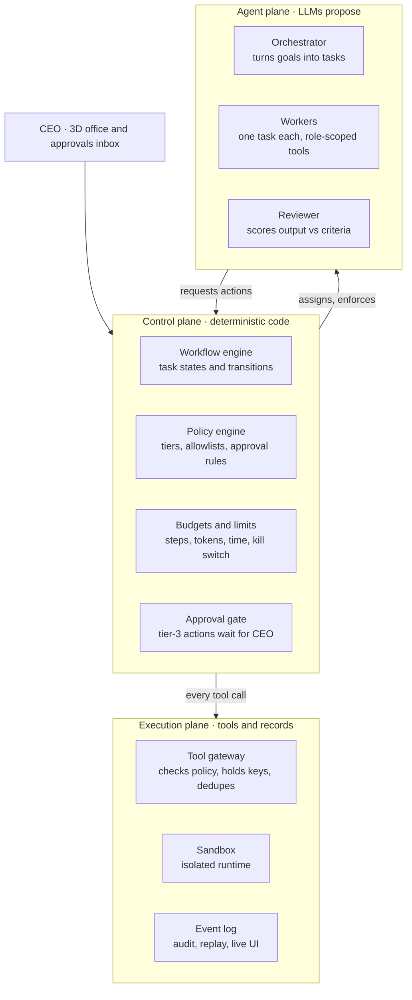
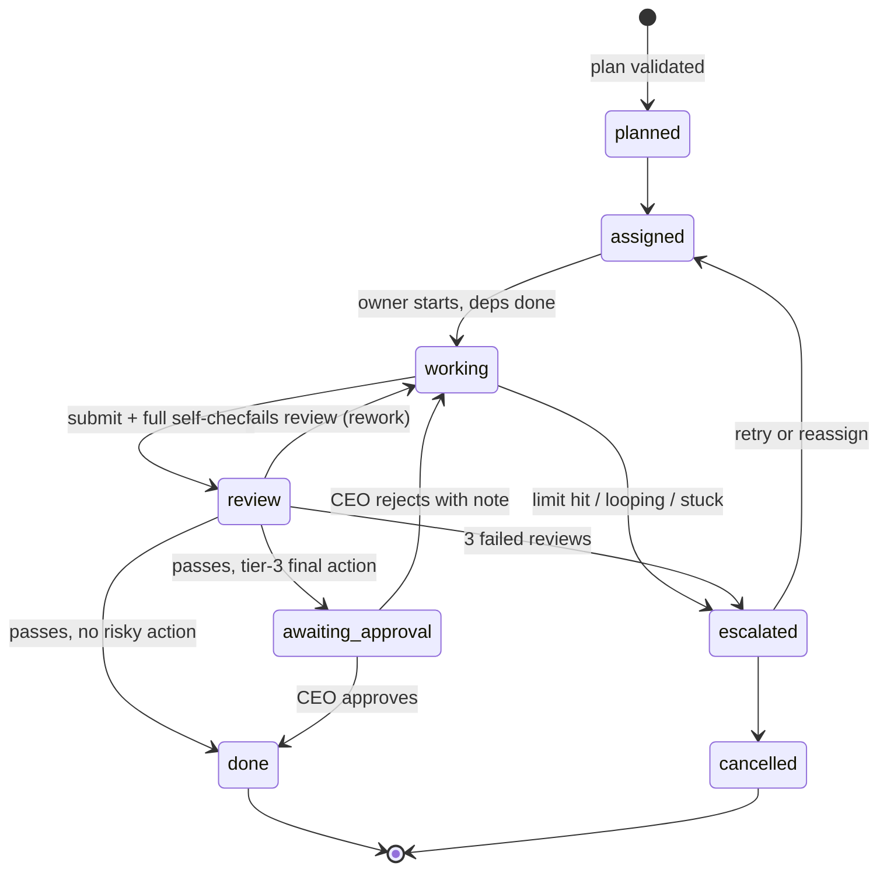

# AI Company: agent control architecture

The AI Company is a workspace where each AI agent works as an employee, shown in a 3D office. One **orchestrator** agent takes goals from the CEO (the user), splits them into tasks and hands them to **worker** agents in departments such as Engineering, Marketing, Sales and Support. A **reviewer** agent checks finished work.

**Core principle: LLMs propose, deterministic code decides.** Agents never change state, call a tool or spend money directly. Every action goes through a control plane of ordinary code that enforces permissions, budgets, quality gates and approvals. No prompt can override it.

Design goals:

- **Safe by default.** Irreversible or costly actions always need a human sign-off.
- **Predictable.** Every task follows one state machine, with hard limits on steps, tokens and time.
- **Quality-checked.** No task is done until it passes automated checks and an independent review.
- **Fully auditable.** Every event is logged and can be replayed, which also drives the 3D office view.

## System layers

Agents send requests up to the control plane, which checks them against the rules and then carries them out through the tool gateway. Every result is written to the event log, which the 3D office reads to show what each agent is doing.

| Component | Package | Status |
| --- | --- | --- |
| Workflow engine, policy engine, limits, event log | `packages/core` | Done |
| Postgres event store, HTTP + WebSocket API | `apps/server` | Done |
| Orchestrator, worker, reviewer agent loops | `packages/agents` | Milestones 3 and 6 |
| Tool gateway and connectors | `packages/gateway` | Milestone 4 |
| 3D office UI | `apps/office` | Prototype (simulated agents) |

## Agent roles

| | Orchestrator | Worker | Reviewer |
| --- | --- | --- | --- |
| Job | Turns goals into tasks, assigns them, tracks progress, reports to the CEO | Completes one task | Scores a finished task against its acceptance criteria |
| Tools | Engine commands only: `submitPlan`, `escalate`, status queries | Real-world tools on its role's allowlist | None: it receives the output and the criteria |
| Can do the work itself | No | Yes | No |
| Context | All goals, team roster and workload, task summaries | Its task, acceptance criteria, relevant files, role memory | The task, its criteria, the output |
| Model | Strongest (e.g. Opus) | Matched to the task (e.g. Sonnet or Haiku) | Strong, and different from the author's where possible |
| Output | Structured JSON plans | Work products plus a short summary | Pass or fail, a score, specific feedback |

Rules:

- Workers never talk to each other directly. All coordination goes through the orchestrator and the task board.
- The orchestrator reads worker summaries, never full transcripts, so its context stays small.
- A reviewer never reviews its own work. The engine enforces this.

## Task lifecycle

The workflow engine owns every task's state. Agents can only request a transition, and the engine checks the guard conditions before allowing it. The legal transitions are in `packages/core/src/state-machine.ts`.

| Transition | Guard checked by the engine |
| --- | --- |
| planned → assigned | Plan passed validation; owner is a worker with the tools the task needs |
| assigned → working | Caller is the owner; owner not paused or benched; dependencies done; goal budget left; company not paused |
| working → review | Worker submitted a summary and a self-check marking every criterion met |
| review → working | Review failed (with feedback) and fewer than 3 attempts used |
| review → done | Review passed; no final action needing approval |
| review → awaiting_approval | Review passed, but the final action needs CEO approval |
| any → escalated | 3 failed reviews or rejections, a step / token / time / budget limit, a tool-call loop, or no progress |

## Risk tiers and permissions

Every tool is tagged with a risk tier, and the policy engine checks that tier on every call (`packages/core/src/policy.ts`).

| Tier | What it covers | Examples | Rule |
| --- | --- | --- | --- |
| 0 · Read | Reading data | Web search, read files, query CRM | Runs automatically |
| 1 · Internal write | Changes inside the company workspace | Draft a doc, create a branch, update a task | Runs automatically, logged |
| 2 · External, reversible | Visible outside but can be undone | Deploy to staging, schedule a post | Runs only if on the `autoApproveTier2` list; otherwise treated like tier 3 |
| 3 · Irreversible or costs money | Cannot be undone, or spends money | Send an email, deploy to production, pay, delete data | Never during work. Proposed as the task's `finalAction`, released only after review and CEO approval |

Permissions:

- **Per-role tool allowlist.** A call to a tool outside the agent's list is refused and logged.
- **Only workers call tools.** Orchestrators and reviewers are denied every real-world tool.
- **Credentials live in the tool gateway.** API keys and OAuth tokens never go into an agent's prompt or context.
- **Scoped access.** Tools get the narrowest scope that works: one repo, one mailbox, one CRM pipeline.
- **Policies are code.** Tiers, allowlists and approval rules are versioned configuration, changed only by the CEO, never by an agent.

## Quality gates

1. **Plan check** (`validatePlan`). The plan must give every task an owner who is a worker, acceptance criteria, a positive cost estimate and only tools the owner has. Dependencies must exist and form no cycle, and the total estimate must fit the remaining goal budget. Any failure rejects the plan with every reason listed; the orchestrator re-plans.
2. **Self-check** (`submitForReview`). The worker must mark every acceptance criterion met, or the submission is refused.
3. **Automated checks.** Deterministic checks by output type, run by the gateway before review: tests, linter and build for code; style, link and length rules for content; schema and recipient-allowlist checks for emails. *(Milestone 5.)*
4. **Independent review** (`recordReview`). A reviewer agent scores the output. A fail needs feedback and sends the task back to `working`.
5. **Human gate** (`decideApproval`). Tier-3 final actions wait for the CEO, who sees the output, the review score and the exact action. A rejection needs a note.

Three failed reviews or rejections escalate the task instead of retrying again.

## Limits and safety controls

Defaults are in `DEFAULT_LIMITS` (`packages/core/src/engine.ts`) and are proposals to tune after testing. The server overrides them from `limits` in `apps/server/config/company.json`.

| Control | Scope | Default | At the limit |
| --- | --- | --- | --- |
| Step limit | Per task | 30 steps | Escalated |
| Token cap | Per task | 200,000 tokens | Escalated |
| Time limit | Per task | 30 minutes in `working` | Escalated |
| Review attempts | Per task | 3 | Escalated |
| Loop detection | Per task | Same tool + input 3 times in a row | Call denied, task escalated |
| Stuck detection | Per task | 5 minutes without activity | Escalated by `checkStuck()` |
| Goal budget | Per goal | Set at goal creation | Warning at 80%, open tasks escalated at 100% |
| Circuit breaker | Per agent | 3 escalations in a row | Agent benched until the CEO un-benches it |
| Kill switch | Whole company | `pauseCompany()` | No task starts and no tool call is allowed |

## Reliability

- **Event sourcing.** Every state change is an event appended to the log. The engine's state is built only by replaying events through one reducer (`apply`), so `WorkflowEngine.fromEvents(log)` rebuilds the company exactly. The server rebuilds the engine from Postgres on every boot.
- **Durable before visible** ([ADR 0002](decisions/0002-durable-before-visible.md)). The engine stays synchronous; the server runs every request through one command queue that awaits a Postgres commit before anything leaves the process: HTTP responses, WebSocket messages and final actions for the gateway. A failed write stops the server, which then rebuilds from the log.
- **One writer, append-only log.** The `events` table uses `seq` as its primary key, rejects UPDATE, DELETE and TRUNCATE, and is guarded by a Postgres advisory lock so only one server writes to a company's log.
- **Idempotency keys.** Every tool call and final action carries a key. A key is never allowed twice; a retry gets `{ kind: 'duplicate' }` and the gateway must not execute it again.
- **Checkpoints.** After each agent step, progress and working notes are saved so a crashed agent resumes where it stopped. *(Milestone 3.)*
- **Dead-letter queue.** Escalated tasks wait in one place for the CEO instead of disappearing or looping.
- **Timeouts on every external call**, with retry and backoff for temporary errors only. *(Milestone 4.)*

## Server (`apps/server`)

The server hosts the engine for one company. Configuration (tools and tiers, `autoApproveTier2`, limits, the agent roster) comes from `apps/server/config/company.json`, written by the CEO. On boot the roster is brought in line with the config through engine commands: new agents go through `registerAgent`, changed ones through `updateAgent` (event `agent.updated`), so a tool removed from the config is revoked. An agent deleted from the config keeps its history but loses every tool and is paused; if it is added back, it stays paused until the CEO resumes it. Changing an agent's kind fails the boot (and writes nothing); give the agent a new id instead.

The `events` table needs one direct connection per server (it holds a session advisory lock), so don't put a transaction-pooling proxy in front of it.

Environment: `DATABASE_URL` and `CEO_TOKEN` (16+ characters) are required. `DB_SCHEMA` (default `public`), `HOST` (default `127.0.0.1`), `PORT` (default `4100`) and `COMPANY_CONFIG` are optional.

`GET /health` is open. Every other route needs `Authorization: Bearer <CEO_TOKEN>`; the token is never accepted in an HTTP query string, which would leak into access logs. Engine refusals return 409 (or 404 for an unknown id) with the engine's reason.

| Method and path | Engine command |
| --- | --- |
| `GET /health` | None: `{ ok }`, 503 once the server has gone fatal |
| `GET /state` | Snapshot of agents, goals, tasks, kill-switch state and the `seq` it reflects |
| `GET /events?since=<seq>` | Up to 1,000 durable events after `seq` |
| `POST /goals` `{ text, budgetTokens }` | `createGoal` |
| `POST /tasks/:id/approval` `{ approved, note? }` | `decideApproval`; a released final action goes to the gateway hook, never to the caller. Until milestone 4 no gateway is wired, so approved actions are only logged, not executed |
| `POST /tasks/:id/resolve` `{ kind: retry \| cancel }` or `{ kind: reassign, ownerId }` | `resolveEscalation` |
| `POST /agents/:id/pause` · `/resume` · `/unbench` | `pauseAgent` · `resumeAgent` · `unbenchAgent` |
| `POST /company/pause` `{ reason? }` · `/company/resume` | Kill switch: `pauseCompany` · `resumeCompany` |

**Event stream.** `GET /stream?since=<seq>` upgrades to a WebSocket. Each message is one `EngineEvent` as JSON: first the backlog after `since`, then live events, in `seq` order with no gaps or repeats and only after they are durable. A client that reconnects with the last `seq` it saw resumes exactly where it stopped. Browsers, which cannot set headers on a WebSocket, may pass the token as `?token=` on this path only. Close code 4409 means the resume point is ahead of the log; 4429 means the client fell too far behind and should reconnect.

**Stuck timer.** Every 30 s the server calls `checkStuck()` through the same command queue.

## Context and memory

- **Context pack.** When a task starts, the worker gets only the task, its criteria, relevant files or records, and its role memory.
- **Summaries, not transcripts.** Finished work is reported as a structured summary; that is all other agents read.

| Scope | Holds | Read by | Written by |
| --- | --- | --- | --- |
| Company | Goals, decisions, policies, knowledge base | All agents (filtered by role) | Orchestrator and CEO |
| Role | How to do the job, templates, lessons | Agents with that role | Agents with that role, after review |
| Task | Working notes and checkpoints | The assigned agent | The assigned agent |

Lessons are promoted to role or company memory only after a task passes review.

## Observability and improvement

- **Live view.** The 3D office subscribes to the event stream; each avatar's animation and status light come from its latest events.
- **Traces.** Every agent step records model call, tool calls, tokens, cost and duration.
- **Replay.** A timeline scrubber replays any goal from its events.
- **Cost dashboard.** Spend per agent, department, goal and day ("payroll").
- **Agent scorecards.** Success rate, first-try review pass rate, escalations, cost and time per task.
- **Golden tasks.** Fixed test tasks per role, re-run whenever a prompt, model or tool changes.
- **Versioning and canary rollout.** Prompts, role templates and policies are versioned; each event records which versions produced it; a change goes to one agent first.
